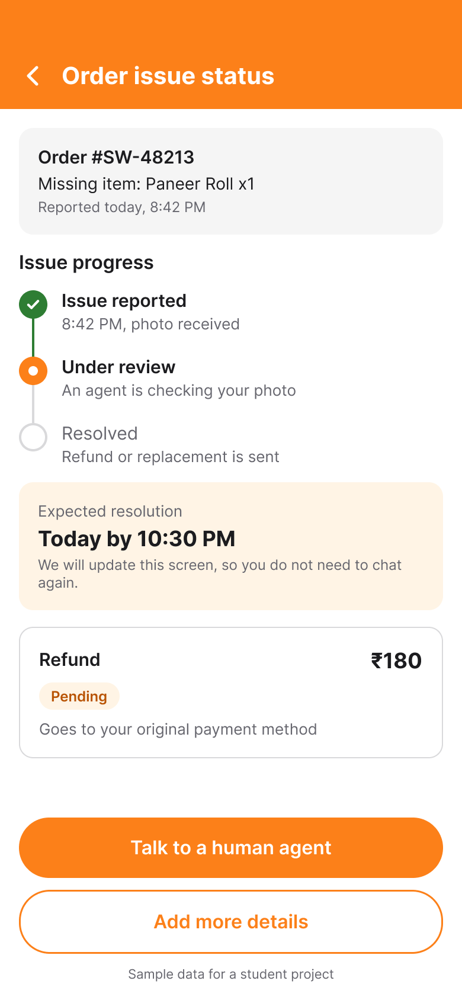

# Swiggy Voice of the Customer: what do reviewers complain about, and what should be built first?

A student product-management project. It turns Play Store reviews into ranked complaint themes using an LLM classifier, measures how accurate that classifier is against hand labels, and uses the result to prioritise a fix with RICE.

## Problem

App reviews are unstructured, so it is hard to say which problem matters most. My starting hypothesis was that **refunds** were the top problem and a refund tracker was the right fix. The data pointed somewhere else: **customer support**.

## Data and limitations

- **Swiggy:** random sample of 600 English and Hinglish Play Store reviews, 29 Oct to 10 Nov 2026 (12 days).
- **Zomato (benchmark):** [FILL: 300 or 150] reviews, 12 to 16 Nov 2026.
- Review writers are not typical users (sampling bias), and one platform only (Android).
- The Swiggy and Zomato samples cover different, non-overlapping dates, so the comparison is indicative, not exact.
- Zomato's sample has slightly more 5-star reviews (30% vs 24%).
- The 12-day window is too short to claim any trend over time.
- Raw review text is not published in this repo.

## Method

1. **Baseline:** keyword matching for each theme.
2. **LLM classifier:** Gemini ([FILL: confirm exact model name in analysis/llm_classify_v3_FINAL.py]) with a fixed theme list, JSON output, and a supporting quote per label. Prompt versions v1 and v3.
3. **Gold set:** 150 reviews I labeled by hand, used to score every version with precision, recall and exact match.
4. **Analysis:** mentions, average rating, model-assigned severity and low-rating mentions per theme.
5. **Prioritisation:** RICE with low, base and high scenarios.

## Evaluation results (150 hand-labeled reviews)

| Version | Exact match | Micro precision | Micro recall | Micro F1 | Support P / R | Refund P / R |
|---|---|---|---|---|---|---|
| Keyword baseline | 45.3% | 0.85 | 0.32 | 0.47 | 1.00 / 0.48 | 1.00 / 0.55 |
| LLM v1 | 76.7% | 0.76 | 0.88 | 0.82 | 0.88 / 1.00 | 0.79 / 1.00 |
| LLM v3 | **84.0%** | 0.87 | 0.92 | **0.90** | 0.91 / 1.00 | 1.00 / 0.91 |

With 150 reviews the 84% is an estimate (roughly 77% to 89%). The prompt was refined while looking at errors from this same set, so the score may be slightly optimistic.

**Error analysis (24 wrong rows):** 14 had the model add an extra theme only, 5 had both an added and a missed theme, and 5 had a missed theme only. The model tends to over-tag ambiguous themes (`other`, `app_experience`, `tracking_partner`) rather than miss clear complaints. Reasons for the errors: [FILL: counts, e.g. definitions overlap X, my label was wrong k, two issues Y, vague Z]. Corrected exact match if my label errors are fixed: [FILL: (126 + k) / 150].

**Check on the `other` tag:** in a 30-review spot check, [FILL: X] of 30 named a real complaint no other theme covered, and 13 were redundant tags next to a specific theme. So the raw `other` count (97) is overstated. Estimated valid `other` mentions: [FILL: range]. The one recurring uncovered complaint was trust / fraud claims (4 of 30).

**Where a human must still review:** reviews tagged `other`, `app_experience` or `tracking_partner`; reviews with several issues; sarcastic or very vague reviews. Counts for these themes are approximate.

## Findings (Swiggy, 600 reviews)

| Theme | Mentions | % of reviews | Avg rating | Avg severity (model) |
|---|---|---|---|---|
| support | 149 | 24.8% | 1.07 | 2.85 |
| delivery_delay | 119 | 19.8% | 1.25 | 2.51 |
| other (overstated) | 97 | 16.2% | 1.44 | 2.37 |
| non_delivery | 74 | 12.3% | 1.01 | 2.92 |
| refund | 73 | 12.2% | 1.10 | 2.85 |
| fees_pricing | 69 | 11.5% | 1.59 | 1.93 |
| wrong_missing_items | 63 | 10.5% | 1.14 | 2.60 |
| tracking_partner | 59 | 9.8% | 1.19 | 2.61 |
| food_quality | 43 | 7.2% | 1.28 | 2.58 |
| app_experience | 36 | 6.0% | 1.67 | 1.61 |
| app_payment | 25 | 4.2% | 1.28 | 2.28 |

- **Support is #1** by mentions, by severity points and by low-rating mentions. A separate 30-review check found about 90% of support tags were correct, and the gold set gave 0.91 precision.
- **Refund is 5th** by mentions, but 34 of 73 refund reviews (47%) also mention support, so refund problems often become support problems.
- **What support complaints look like** (keyword counts, approximate): 15% mention bot-only or automated replies, 7% mention being asked for photos or proof, 7% say they had to try repeatedly, and only 4% say there was no reply at all.
- **Refund complaints:** 26% say the refund has not arrived. Waits mentioned range from 1 hour to 7 days. Only 1 of 73 explicitly complains about unclear status.
- **Zomato benchmark:** [FILL: is support also #1 for Zomato? Compare % of reviews, not raw counts.]

## Recommendation (RICE, low / base / high)

| Option | Low | Base | High |
|---|---|---|---|
| Human escalation + better resolution flow | 5,588 | 27,938 | 178,800 |
| Refund status tracker | 3,042 | 20,278 | 146,000 |
| More support staff | 3,492 | 18,625 | 134,100 |
| Faster backend refunds | 2,535 | 13,519 | 73,000 |

Support-related options beat refund-related options in every scenario, mainly because support reaches about twice as many reviewers. Impact, confidence and effort are my estimates, and the escalation-flow row is the least certain, so the choice between support fixes should be settled with user interviews. The refund tracker is a hypothesis: the reviews rarely complain about missing status. Full workings are in `docs/RICE_scoring_updated.xlsx`.

## Mockup

A status screen with progress stages, an expected resolution time, a refund line and a "Talk to a human agent" button. Each element is tied to a number from the review data. Sample data only, not yet validated with users.

## Review-based insights and interviews

The five interview questions were answered from the review data as a stand-in (`analysis/review_voice.py`). **This is not user research.** Real interviews: [FILL: "not yet done" or number completed with 2-3 insights].

## Experiment plan

- **Hypothesis:** an issue-status screen reduces repeat support contacts about the same issue.
- **Who:** a random 50% of users who report an order issue.
- **Main metric:** support contacts per issue.
- **Safety metric:** repeat orders within 30 days must not drop.
- **Duration:** 2 to 4 weeks, or until enough issues are logged.
- **Stop rule:** stop if repeat orders drop by more than an agreed threshold. [FILL: your number, state as an assumption]

## Cost

[FILL: approximate cost per 1,000 reviews from Google's current pricing, or "free tier, capped at 500 requests per day".]

## What I would do next

- Test a v4 prompt: use `other` only when nothing else fits, never alongside a specific theme; tighten `tracking_partner` and `app_experience`.
- Add candidate themes: trust / fraud claims, cancellations, service availability.
- Run real user interviews and update the RICE confidence values.
- Re-score the full gold set after any prompt change as a regression test.

## Repo guide

- `analysis/`: scraping, classifier, evaluation, error breakdown and analysis scripts
- `docs/`: RICE workbook and mockup
- `data/`: local data (raw reviews are git-ignored)

Run order: scrape, classify, `evaluate.py`, `full_analysis.py`.