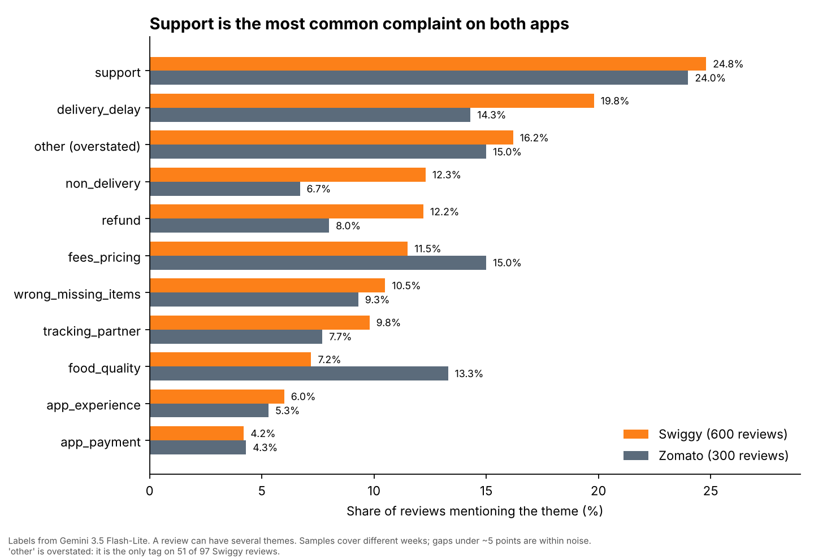

# ReviewLens AI: Swiggy and Zomato Voice-of-Customer Pipeline

An AI-powered, evaluated LLM pipeline that turns Play Store reviews of Swiggy and Zomato into ranked complaint themes, measures how accurate the classifier really is, and uses the result to prioritise one product fix with RICE. A student product-management project.

## Key findings

- **Customer support is the most common complaint on both apps:** 24.8% of 600 Swiggy reviews and 24.0% of 300 Zomato reviews. On Swiggy, 147 of the 149 support complaints sit in 1 and 2 star reviews.
- **Refunds, my starting hypothesis, rank 5th on Swiggy (12.2%, about level with non-delivery at 12.3%).** But 47% of refund reviews also mention support, so refund problems often turn into support problems.
- **The LLM clearly beats keyword matching:** exact match rose from 45% to about 83-85% on my 150-review gold set (the set the prompt was tuned on; v3 varied between runs, see Error analysis) and is 74% on a separate 50-review test set (see the caveats under Method).
- **Recommendation:** a human-escalation and resolution flow for support ranks first in all three RICE scenarios. These are estimates and need user validation.

## Problem

App reviews are unstructured, so it is hard to say which problem matters most. I started with the hypothesis that refunds were the top problem and that a refund tracker was the right fix. The data pointed somewhere else.

## Data and limitations

- **Swiggy:** random sample of 600 English and Hinglish Play Store reviews from 29 Oct to 10 Nov 2026 (12 days). The window was chosen so all star ratings are covered.
- **Zomato (benchmark):** 300 reviews from 12 to 16 Nov 2026. A different, shorter window, so the comparison is indicative, not exact. Zomato's sample has more 5-star reviews (30% vs 24%).
- **Rating mix:** about 63% of the Swiggy sample is 1-star and 24% is 5-star (only 12.5% are 2 to 4 stars). Shares in this repo therefore describe complaints in these samples, not how common each problem is among all users.
- **Accuracy was measured on Swiggy reviews only.** Zomato uses the v3 prompt with the app name and the wallet-credit wording in rule 7 changed, and has no separate accuracy check, so the gaps between the apps are indicative.
- Review writers are not typical users (sampling bias), and the data covers one platform (Android) only.
- The window is too short to claim any trend over time.
- **The model's severity score is unreliable, so I do not use it.** In my check, only 4 of the 24 reviews it called "ready to quit" were truly at that level, and it labelled 20 of 42 "serious" reviews the same way. I rank themes by mentions, share of reviews and star ratings instead.
- Raw review text is not published in this repo.

## Method

1. **Baseline:** keyword matching for each theme.
2. **LLM classifier:** Gemini 3.5 Flash-Lite (`gemini-3.5-flash-lite`) with a fixed theme list, JSON output and a supporting quote for each label. Three prompt versions: v1, v2 (nine rules written from v1 errors) and v3 (final). The prompt text in `docs/prompt_v3_FINAL.txt` is checked to be identical to the code in `analysis/llm_classify_v3_FINAL.py`.
3. **Gold set:** 150 reviews (30 per star rating). Labels were drafted with AI assistance and then reviewed by me; I changed TODO_N labels. Four labels were corrected after I reviewed v1's errors. v1 scored 77.3% on the original labels, 79.3% after those four corrections, and 76.7% on the final labels after the theme list changed. Because the gold labels were AI-drafted, agreement with an AI classifier may be inflated. The gold set is balanced by rating but the Swiggy sample is not, so accuracy on the full sample may differ.
4. **Test set:** 50 further reviews. TODO_TEST_SET: say how they were chosen (random or by rating) and who drafted and checked the labels. Not used to write the v1 or v2 rules. The v3 prompt may have been informed by test-set errors, so 74% may be slightly optimistic.
5. **Analysis:** mentions, share of reviews, average rating and 1-2 star mentions per theme.
6. **Prioritisation:** RICE with low, base and high scenarios.

## Evaluation results

**Gold set (150 reviews, the set the prompt was tuned on):**

| Version | Exact match (95% range) | Micro precision | Micro recall | Micro F1 |
| --- | --- | --- | --- | --- |
| Keyword baseline | 45.3% (38-53%) | 0.85 | 0.32 | 0.47 |
| LLM v1 | 76.7% (69-83%) | 0.76 | 0.88 | 0.82 |
| LLM v2 | 81.3% (74-87%) | 0.83 | 0.87 | 0.85 |
| LLM v3 (final) | 85.3% (79-90%) | 0.88 | 0.90 | 0.89 |

The v3 row is the run saved as `pred_llm_v3_check.csv`, which is also the best of the three v3 runs on this set (see Error analysis).

**Test set (50 reviews not used to write the v1 or v2 rules):**

| Version | Exact match (95% range) | Micro precision | Micro recall | Micro F1 |
| --- | --- | --- | --- | --- |
| LLM v2 | 72.0% (58-83%) | 0.67 | 0.83 | 0.74 |
| LLM v3 (final) | 74.0% (60-84%) | 0.70 | 0.81 | 0.75 |

"Exact match" means the predicted themes equal the labelled themes for a review. The 95% ranges are Wilson intervals. The keyword baseline was only run on the gold set.

The 74% on the test set is the more honest accuracy figure, though it may still be slightly optimistic (see Method). It comes from a single run, so a rerun could differ by a few points. The 85% is optimistic because the rules were written while looking at errors on the gold set. On the test set, v2 and v3 are not meaningfully different (50 reviews is about plus or minus 10 points). Per-theme scores for small themes (2 payment, 4 non-delivery and 5 tracking reviews in the gold set) are too noisy to quote.

**Error analysis.** On the current labels v1 got 35 of the 150 gold reviews wrong and v2 got 28. v3 was run on the gold set three times and the number of errors varied: 22 (85.3%, the run scored in the table above), 24 (84.0%) and 26 (82.7%). The classifier is not fully deterministic, so differences of 1 to 2 points between runs are within noise. TODO_V3_BREAKDOWN: for the 22-error run, say how many reviews had an extra theme added, a theme missed, or both, and which themes were added most often. TODO_OVERTAG: keep the next sentence only if most of those errors involve an added theme. So the model mostly over-tags and blurs neighbouring themes, rather than missing clear complaints.

**Support tag check.** In a manual check of 30 reviews tagged support, 27 (90%) were real support complaints. This measures precision only, not recall.

**The `other` tag is overstated.** `other` appears in 97 of 600 reviews, but is the only tag in 51 (8.5%). The v3 prompt already says never to add `other` when another theme fits, yet the model still did so on 46 reviews. In a 30-review spot check of `other` tags (labels drafted with AI help and reviewed by me): 8 named a real complaint no theme covers, 13 were redundant tags next to a specific theme, 8 were generic insults and 1 was unclear. The one recurring uncovered complaint was trust and fraud claims (4 of 30).

**Where a human must still review:** reviews tagged `other`, `app_experience` or `tracking_partner`, reviews with several issues, and sarcastic or very vague reviews.

## Findings: Swiggy vs Zomato

| Theme | Swiggy (600) | Zomato (300) |
| --- | --- | --- |
| support | **24.8%** | **24.0%** |
| delivery_delay | 19.8% | 14.3% |
| other (overstated) | 16.2% | 15.0% |
| non_delivery | 12.3% | 6.7% |
| refund | 12.2% | 8.0% |
| fees_pricing | 11.5% | 15.0% |
| wrong_missing_items | 10.5% | 9.3% |
| tracking_partner | 9.8% | 7.7% |
| food_quality | 7.2% | 13.3% |
| app_experience | 6.0% | 5.3% |
| app_payment | 4.2% | 4.3% |

Share of reviews mentioning each theme (a review can have several).

- **Support is the top theme on both apps at about 24%**, so the problem looks similar on both, not Swiggy-specific. Accuracy was only measured on Swiggy, so treat this as indicative. On Zomato, 70 of 72 support reviews are 1-2 stars.
- With 300 and 600 reviews and different weeks, gaps under about 5 points are within noise. Only non-delivery (12.3% vs 6.7%) and food quality (7.2% vs 13.3%) are large enough to be worth noting, and even those are indicative. The refund and fees gaps are within noise.
- **What Swiggy support complaints look like** (keyword counts, approximate): 15% mention bot-only or automated replies, 7% mention being asked for photos or proof, 7% say they had to try repeatedly, and only 4% say there was no reply at all.
- **Refund complaints:** 26% say the refund has not arrived. Waits mentioned range from 1 hour to 7 days. Only 1 of 73 explicitly complains about unclear status. The Zomato refund group is only 24 reviews, so its breakdown is too small to compare.

## Recommendation (RICE, low / base / high)

| Option | Low | Base | High |
| --- | --- | --- | --- |
| Human escalation + better resolution flow | 5,588 | 27,938 | 178,800 |
| Refund status tracker | 3,042 | 20,278 | 146,000 |
| More support staff | 3,492 | 18,625 | 134,100 |
| Faster backend refunds | 2,535 | 13,519 | 73,000 |

The best support option outranks the best refund option in all three scenarios, mainly because support reaches about twice as many reviewers (about 25% vs 12%). Impact, confidence and effort are my estimates, and the escalation-flow row is the least certain, so the choice between support fixes should be settled with user interviews. The refund tracker is a hypothesis: reviews rarely complain about missing status. Full workings are in `docs/RICE_scoring_updated.xlsx`.

## Mockup

A status screen with progress stages, an expected resolution time, a refund line and a "Talk to a human agent" button. Each element is tied to a number from the review data. Sample data only, not validated with users.

## Review-based insights and interviews

The five interview questions were answered from the review data as a stand-in (`analysis/review_voice.py`). All counts there are keyword matches, so they are approximate, and the "competitor" lines look for the other app's name (Zomato in Swiggy reviews, Swiggy in Zomato reviews). **This is not user research. I have not yet run user interviews.**

## Experiment plan

- **Hypothesis:** an issue-status screen reduces repeat support contacts about the same issue.
- **Who:** a random 50% of users who report an order issue.
- **Main metric:** support contacts per issue.
- **Safety metric:** repeat orders within 30 days must not drop.
- **Duration:** 2 to 4 weeks, or until enough issues are logged.
- **Stop rule:** stop if 30-day repeat orders fall by more than 1 percentage point versus control (an assumed threshold).

## Cost

The project ran on Google's free tier, which allowed about 500 requests per day for this model at the time I ran it (limits change). Paid cost per 1,000 reviews was not measured.

## What I would do next

- Label a fresh test set that is never looked at while writing prompts, and run the keyword baseline on it too, so the comparison with the LLM is like for like.
- Add a post-processing rule that drops `other` when a specific theme is present, and test it on the test set.
- Add candidate themes: trust and fraud claims, cancellations, service availability.
- Check the classifier on a labelled set of Zomato reviews before relying on the Swiggy vs Zomato gaps.
- Run real user interviews and update the RICE confidence values.
- Re-score the gold and test sets after any prompt change as a regression test.

## Repo guide

- `analysis/`: scraping, classifiers (v1 to v3), scoring, error breakdown and analysis scripts. Old experiments are in `analysis/scratch/`.
- `docs/`: RICE workbook, final prompt, findings notes and mockup.
- `data/`: results text files. `results_final_scores.txt` is the current one; older results files were produced on earlier versions of the labels. Raw review data is git-ignored.

Run order for Swiggy: `scrape_reviews.py`, `make_window.py`, `llm_classify_v3_FINAL.py`, `score_all.py`, `full_analysis.py`, `review_voice.py`.
For Zomato: `scrape_zomato.py`, `llm_classify_v3_zomato.py`, then `review_voice.py` with the Zomato files. `make_rice.py` builds the RICE workbook.

